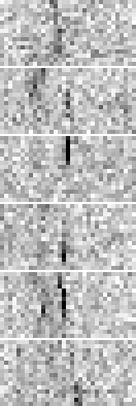

# SETI-KIC8462852-AGBT17A_999_68-1924.646580: likely interference (indicated: zero or very low drift; look-alikes in the cadence; crowding)

Checked by `check.py` (vetting 4 (11 Nov 2026: checks 7 and 9 take their chances from the session's measured occupancy, by drift (occupancy.py), when the store gives it)) on 2026-11-11. "Unexplained" is the end of these checks, not a discovery.

- 1924.646580 MHz, drift +0.0102 Hz/s, SNR 11.9, target KIC8462852
- OFF looks' brightest S/N along the track: 5.79; faintest ON look: 6.73; DOT score 0.032; ON drifts spread 2.0 steps



## The checks

| # | check | result | strength |
|---|---|---|---|
| 1 | data sanity | not sound |  |
| 2 | OFF looks below the threshold | nothing in the OFF looks (brightest S/N 5.79) |  |
| 3 | known interference bands | in no listed band |  |
| 4 | zero or very low drift | +0.0102 Hz/s (under one drift step) | indicated |
| 5 | drift against the Earth's | observed +0.0102, Earth's -0.0933 Hz/s, difference +0.1035 |  |
| 6 | recurrence at other targets and times | 1 match(es) in 1 hits elsewhere, 1 within 3 days with the drift agreeing (1 at the cut) | coincidence possible |
| 7 | look-alikes in the cadence | 8439 look-alike(s), 4222 in OFF looks | indicated |
| 8 | harmonics and intermodulation | 2 MHz spacing, 10 MHz spacing, 15 MHz spacing, 16 MHz spacing, 30 MHz spacing, 2f1+-1f2, 3f1+-2f2 | coincidence possible |
| 9 | crowding | 8277 hits at its drift within 0.5 MHz; as many at 0.16% of the band's places | indicated |
| 10 | report | likely interference (indicated: zero or very low drift; look-alikes in the cadence; crowding) |  |

## blc1's ten steps

| step | what | here |
|---|---|---|
| 1 | instruments working | automated (check 1) |
| 2 | not in the OFF looks below the threshold | automated (check 2) |
| 3 | catalogued interference at the frequency | automated (check 3: a band list, no observatory database) |
| 4 | drift against human technology's | automated in part (check 4: zero drift only) |
| 5 | drift against the target's and the solar system's | automated (check 5: the Earth's part) |
| 6 | other instances in the observatory's archive | automated in part (check 6: this project's store only) |
| 7 | similar signals at other frequencies, same observation | automated (check 7) |
| 8 | whether those are the same phenomenon | automated in part (checks 7, 8 with chance rates); judged by hand |
| 9 | those tested for interference with their OFF looks | automated (check 7) |
| 10 | re-observation, same and other instruments | not possible from archive data: the project has no telescope |

## The evidence

```json
{
 "data sanity": {
  "every_look_complete": false,
  "stamps_finite": true,
  "blank_stamp_spectra": 0,
  "flagged_fraction": 0.5
 },
 "OFF looks below the threshold": {
  "off_snr_max": 5.79,
  "threshold": 6.0,
  "per_look": [
   {
    "position": 1,
    "track_snr": 4.49,
    "track_snr_fixed": 4.83,
    "hit_snr": null
   },
   {
    "position": 3,
    "track_snr": 5.79,
    "track_snr_fixed": 5.63,
    "hit_snr": null
   },
   {
    "position": 5,
    "track_snr": 4.72,
    "track_snr_fixed": 4.4,
    "hit_snr": null
   }
  ]
 },
 "known interference bands": {
  "band": null
 },
 "zero or very low drift": {
  "drift_hz_s": 0.0102,
  "one_step_hz_s": 0.0102
 },
 "drift against the Earth's": {
  "observed": 0.0102,
  "expected": -0.0933,
  "rotation": -0.0899,
  "orbit": -0.0034,
  "difference": 0.1035
 },
 "recurrence at other targets and times": {
  "matches": [
   {
    "frequency_mhz": 1924.646686,
    "drift_hz_s": 0.0102,
    "snr": 10.1,
    "mjd": 57898.270590277774,
    "target": "KIC8462852_OFF",
    "session": "AGBT17A_999_68",
    "shadow": false,
    "days": 0.004,
    "drift_agrees": true
   }
  ],
  "hits_searched": 1,
  "expected_by_chance": 0.6035,
  "chance": 0.4531225887325383,
  "close_at_cut": 1,
  "expected_close_at_cut": 0.46154,
  "chance_close": 0.3696862322919203,
  "background": {
   "source": "measured: each file's hits over the band searched near the candidate",
   "files": 3,
   "searched_mhz": 9.0,
   "hits": 8369,
   "drift_agree_share": 0.819
  }
 },
 "look-alikes in the cadence": {
  "normalised_drift": 5.2996742913704195e-12,
  "tolerance": 1.0603770943795866e-11,
  "lookalikes": [
   {
    "position": 0,
    "frequency_mhz": 1924.653283,
    "drift_hz_s": -0.0102,
    "snr": 36.8,
    "shadow": false,
    "mirror": false
   },
   {
    "position": 0,
    "frequency_mhz": 1924.654183,
    "drift_hz_s": -0.0102,
    "snr": 36.6,
    "shadow": false,
    "mirror": false
   },
   {
    "position": 0,
    "frequency_mhz": 1924.653783,
    "drift_hz_s": -0.0102,
    "snr": 35.8,
    "shadow": false,
    "mirror": false
   },
   {
    "position": 0,
    "frequency_mhz": 1924.652783,
    "drift_hz_s": -0.0102,
    "snr": 35.2,
    "shadow": false,
    "mirror": false
   },
   {
    "position": 0,
    "frequency_mhz": 1924.652383,
    "drift_hz_s": -0.0102,
    "snr": 33.1,
    "shadow": false,
    "mirror": false
   },
   {
    "position": 0,
    "frequency_mhz": 1924.652283,
    "drift_hz_s": -0.0102,
    "snr": 33.0,
    "shadow": false,
    "mirror": false
   },
   {
    "position": 0,
    "frequency_mhz": 1924.654283,
    "drift_hz_s": -0.0102,
    "snr": 32.7,
    "shadow": false,
    "mirror": false
   },
   {
    "position": 0,
    "frequency_mhz": 1924.651783,
    "drift_hz_s": -0.0102,
    "snr": 32.5,
    "shadow": false,
    "mirror": false
   },
   {
    "position": 0,
    "frequency_mhz": 1924.655183,
    "drift_hz_s": -0.0102,
    "snr": 30.7,
    "shadow": false,
    "mirror": false
   },
   {
    "position": 0,
    "frequency_mhz": 1924.654683,
    "drift_hz_s": -0.0102,
    "snr": 30.4,
    "shadow": false,
    "mirror": false
   },
   {
    "position": 0,
    "frequency_mhz": 1924.651383,
    "drift_hz_s": -0.0102,
    "snr": 30.2,
    "shadow": false,
    "mirror": false
   },
   {
    "position": 0,
    "frequency_mhz": 1924.651883,
    "drift_hz_s": -0.0102,
    "snr": 30.1,
    "shadow": false,
    "mirror": false
   },
   {
    "position": 0,
    "frequency_mhz": 1924.654783,
    "drift_hz_s": -0.0102,
    "snr": 29.7,
    "shadow": false,
    "mirror": false
   },
   {
    "position": 0,
    "frequency_mhz": 1924.651282,
    "drift_hz_s": -0.0102,
    "snr": 29.4,
    "shadow": false,
    "mirror": false
   },
   {
    "position": 0,
    "frequency_mhz": 1924.988182,
    "drift_hz_s": -0.0102,
    "snr": 28.9,
    "shadow": false,
    "mirror": false
   },
   {
    "position": 0,
    "frequency_mhz": 1924.986282,
    "drift_hz_s": -0.0102,
    "snr": 28.9,
    "shadow": false,
    "mirror": false
   },
   {
    "position": 0,
    "frequency_mhz": 1924.987282,
    "drift_hz_s": -0.0102,
    "snr": 28.5,
    "shadow": false,
    "mirror": false
   },
   {
    "position": 0,
    "frequency_mhz": 1924.987682,
    "drift_hz_s": -0.0102,
    "snr": 28.3,
    "shadow": false,
    "mirror": false
   },
   {
    "position": 0,
    "frequency_mhz": 1924.986782,
    "drift_hz_s": -0.0102,
    "snr": 28.0,
    "shadow": false,
    "mirror": false
   },
   {
    "position": 0,
    "frequency_mhz": 1924.987182,
    "drift_hz_s": -0.0102,
    "snr": 27.9,
    "shadow": false,
    "mirror": false
   },
   {
    "position": 0,
    "frequency_mhz": 1924.986682,
    "drift_hz_s": -0.0102,
    "snr": 27.9,
    "shadow": false,
    "mirror": false
   },
   {
    "position": 0,
    "frequency_mhz": 1924.985782,
    "drift_hz_s": -0.0102,
    "snr": 27.4,
    "shadow": false,
    "mirror": false
   },
   {
    "position": 0,
    "frequency_mhz": 1924.989082,
    "drift_hz_s": -0.0102,
    "snr": 27.2,
    "shadow": false,
    "mirror": false
   },
   {
    "position": 0,
    "frequency_mhz": 1924.989182,
    "drift_hz_s": -0.0102,
    "snr": 27.2,
    "shadow": false,
    "mirror": false
   },
   {
    "position": 0,
    "frequency_mhz": 1924.655683,
    "drift_hz_s": -0.0102,
    "snr": 26.6,
    "shadow": false,
    "mirror": false
   },
   {
    "position": 0,
    "frequency_mhz": 1924.988682,
    "drift_hz_s": -0.0102,
    "snr": 26.2,
    "shadow": false,
    "mirror": false
   },
   {
    "position": 0,
    "frequency_mhz": 1924.650883,
    "drift_hz_s": -0.0102,
    "snr": 25.9,
    "shadow": false,
    "mirror": false
   },
   {
    "position": 0,
    "frequency_mhz": 1924.989582,
    "drift_hz_s": -0.0102,
    "snr": 25.8,
    "shadow": false,
    "mirror": false
   },
   {
    "position": 0,
    "frequency_mhz": 1924.985282,
    "drift_hz_s": -0.0102,
    "snr": 25.7,
    "shadow": false,
    "mirror": false
   },
   {
    "position": 0,
    "frequency_mhz": 1924.650782,
    "drift_hz_s": -0.0102,
    "snr": 25.5,
    "shadow": false,
    "mirror": false
   }
  ],
  "in_off": 4222,
  "expected_by_chance": 27.7556,
  "chance": 0.006514657980456026,
  "off_hits": 5440,
  "method": "measured",
  "measured": {
   "observed": 4222,
   "blocks": 307,
   "blocks_with_as_many": 2,
   "chance": 0.006514657980456026,
   "median_per_block": 0.0
  },
  "note": "chance: the share of the session's other blocks whose OFF looks hold as many hits at the cut with this drift over frequency (occupancy.py)"
 },
 "harmonics and intermodulation": {
  "relations": [
   "2 MHz spacing",
   "10 MHz spacing",
   "15 MHz spacing",
   "16 MHz spacing",
   "30 MHz spacing",
   "2f1+-1f2",
   "3f1+-2f2"
  ],
  "chance": 1.0,
  "hits_compared": 72555,
  "strong_zero_drift": 31713,
  "trials": 200
 },
 "crowding": {
  "hits_near": 9650,
  "median_per_mhz": 0.0,
  "ratio": 9650.0,
  "chance": 0.0015845928815212092,
  "method": "measured",
  "measured": {
   "near": 8277,
   "near_at_cut": 7656,
   "drift_tolerance_hz_s": 0.0204,
   "places": 90244,
   "places_as_crowded": 143,
   "chance": 0.0015845928815212092,
   "median_per_place": 13.0,
   "cut_short": true,
   "hits": "SNR 5 and up (shadow hits included), within 0.5 MHz, own 5 kHz left out"
  }
 },
 "report": {
  "checklist": [
   {
    "step": 1,
    "what": "instruments working",
    "here": "automated (check 1)"
   },
   {
    "step": 2,
    "what": "not in the OFF looks below the threshold",
    "here": "automated (check 2)"
   },
   {
    "step": 3,
    "what": "catalogued interference at the frequency",
    "here": "automated (check 3: a band list, no observatory database)"
   },
   {
    "step": 4,
    "what": "drift against human technology's",
    "here": "automated in part (check 4: zero drift only)"
   },
   {
    "step": 5,
    "what": "drift against the target's and the solar system's",
    "here": "automated (check 5: the Earth's part)"
   },
   {
    "step": 6,
    "what": "other instances in the observatory's archive",
    "here": "automated in part (check 6: this project's store only)"
   },
   {
    "step": 7,
    "what": "similar signals at other frequencies, same observation",
    "here": "automated (check 7)"
   },
   {
    "step": 8,
    "what": "whether those are the same phenomenon",
    "here": "automated in part (checks 7, 8 with chance rates); judged by hand"
   },
   {
    "step": 9,
    "what": "those tested for interference with their OFF looks",
    "here": "automated (check 7)"
   },
   {
    "step": 10,
    "what": "re-observation, same and other instruments",
    "here": "not possible from archive data: the project has no telescope"
   }
  ],
  "rio": "not needed"
 }
}
```
