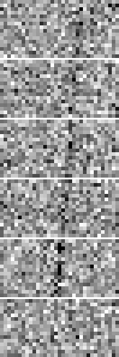

# SETI-KIC8462852-AGBT17A_999_68-2104.591596: likely interference (indicated: known interference bands; recurrence at other targets and times; look-alikes in the cadence; crowding)

Checked by `check.py` (vetting 4 (11 Nov 2026: checks 7 and 9 take their chances from the session's measured occupancy, by drift (occupancy.py), when the store gives it)) on 2026-11-11. "Unexplained" is the end of these checks, not a discovery.

- 2104.591596 MHz, drift +0.0714 Hz/s, SNR 11.1, target KIC8462852
- OFF looks' brightest S/N along the track: 5.69; faintest ON look: 5.65; DOT score 0.002; ON drifts spread 1.0 steps



## The checks

| # | check | result | strength |
|---|---|---|---|
| 1 | data sanity | sound |  |
| 2 | OFF looks below the threshold | nothing in the OFF looks (brightest S/N 5.69) |  |
| 3 | known interference bands | space operation and research uplinks | indicated |
| 4 | zero or very low drift | +0.0714 Hz/s |  |
| 5 | drift against the Earth's | observed +0.0714, Earth's -0.1062 Hz/s, difference +0.1776 |  |
| 6 | recurrence at other targets and times | 1 match(es) in 1 hits elsewhere, 1 within 3 days with the drift agreeing (0 at the cut) | indicated |
| 7 | look-alikes in the cadence | 197 look-alike(s), 53 in OFF looks | indicated |
| 8 | harmonics and intermodulation | 2 MHz spacing, 10 MHz spacing, 15 MHz spacing, 25 MHz spacing, 30 MHz spacing | coincidence possible |
| 9 | crowding | 308 hits at its drift within 0.5 MHz; as many at 0.81% of the band's places | indicated |
| 10 | report | likely interference (indicated: known interference bands; recurrence at other targets and times; look-alikes in the cadence; crowding) |  |

## blc1's ten steps

| step | what | here |
|---|---|---|
| 1 | instruments working | automated (check 1) |
| 2 | not in the OFF looks below the threshold | automated (check 2) |
| 3 | catalogued interference at the frequency | automated (check 3: a band list, no observatory database) |
| 4 | drift against human technology's | automated in part (check 4: zero drift only) |
| 5 | drift against the target's and the solar system's | automated (check 5: the Earth's part) |
| 6 | other instances in the observatory's archive | automated in part (check 6: this project's store only) |
| 7 | similar signals at other frequencies, same observation | automated (check 7) |
| 8 | whether those are the same phenomenon | automated in part (checks 7, 8 with chance rates); judged by hand |
| 9 | those tested for interference with their OFF looks | automated (check 7) |
| 10 | re-observation, same and other instruments | not possible from archive data: the project has no telescope |

## The evidence

```json
{
 "data sanity": {
  "every_look_complete": true,
  "stamps_finite": true,
  "blank_stamp_spectra": 0,
  "flagged_fraction": 0.125
 },
 "OFF looks below the threshold": {
  "off_snr_max": 5.69,
  "threshold": 6.0,
  "per_look": [
   {
    "position": 1,
    "track_snr": 3.64,
    "track_snr_fixed": 2.64,
    "hit_snr": null
   },
   {
    "position": 3,
    "track_snr": 5.69,
    "track_snr_fixed": 2.01,
    "hit_snr": null
   },
   {
    "position": 5,
    "track_snr": 3.02,
    "track_snr_fixed": 3.21,
    "hit_snr": null
   }
  ]
 },
 "known interference bands": {
  "band": [
   2025.0,
   2110.0,
   "space operation and research uplinks"
  ]
 },
 "zero or very low drift": {
  "drift_hz_s": 0.0714,
  "one_step_hz_s": 0.0102
 },
 "drift against the Earth's": {
  "observed": 0.0714,
  "expected": -0.1062,
  "rotation": -0.1025,
  "orbit": -0.0037,
  "difference": 0.1776
 },
 "recurrence at other targets and times": {
  "matches": [
   {
    "frequency_mhz": 2104.591566,
    "drift_hz_s": 0.0918,
    "snr": 5.7,
    "mjd": 57898.270590277774,
    "target": "KIC8462852_OFF",
    "session": "AGBT17A_999_68",
    "shadow": true,
    "days": 0.004,
    "drift_agrees": true
   }
  ],
  "hits_searched": 1,
  "expected_by_chance": 0.1508,
  "chance": 0.14001624277132207,
  "close_at_cut": 0,
  "expected_close_at_cut": 0.01224,
  "chance_close": 1.0,
  "background": {
   "source": "measured: each file's hits over the band searched near the candidate",
   "files": 3,
   "searched_mhz": 9.0,
   "hits": 1451,
   "drift_agree_share": 0.2984
  }
 },
 "look-alikes in the cadence": {
  "normalised_drift": 3.392582206243876e-11,
  "tolerance": 9.697136261908784e-12,
  "lookalikes": [
   {
    "position": 0,
    "frequency_mhz": 2105.476013,
    "drift_hz_s": 0.0816,
    "snr": 26.3,
    "shadow": false,
    "mirror": false
   },
   {
    "position": 0,
    "frequency_mhz": 2104.997647,
    "drift_hz_s": 0.0816,
    "snr": 24.2,
    "shadow": false,
    "mirror": false
   },
   {
    "position": 0,
    "frequency_mhz": 2105.31054,
    "drift_hz_s": 0.0816,
    "snr": 23.1,
    "shadow": false,
    "mirror": false
   },
   {
    "position": 0,
    "frequency_mhz": 2105.295498,
    "drift_hz_s": 0.0816,
    "snr": 22.0,
    "shadow": false,
    "mirror": false
   },
   {
    "position": 0,
    "frequency_mhz": 2105.397788,
    "drift_hz_s": 0.0918,
    "snr": 20.5,
    "shadow": false,
    "mirror": false
   },
   {
    "position": 0,
    "frequency_mhz": 2105.105958,
    "drift_hz_s": 0.0714,
    "snr": 18.2,
    "shadow": false,
    "mirror": false
   },
   {
    "position": 0,
    "frequency_mhz": 2105.400797,
    "drift_hz_s": 0.0918,
    "snr": 18.0,
    "shadow": false,
    "mirror": false
   },
   {
    "position": 0,
    "frequency_mhz": 2105.358678,
    "drift_hz_s": 0.0816,
    "snr": 17.8,
    "shadow": false,
    "mirror": false
   },
   {
    "position": 0,
    "frequency_mhz": 2105.154095,
    "drift_hz_s": 0.0714,
    "snr": 17.5,
    "shadow": false,
    "mirror": false
   },
   {
    "position": 0,
    "frequency_mhz": 2105.382745,
    "drift_hz_s": 0.0918,
    "snr": 17.3,
    "shadow": false,
    "mirror": false
   },
   {
    "position": 0,
    "frequency_mhz": 2105.214266,
    "drift_hz_s": 0.0816,
    "snr": 17.3,
    "shadow": false,
    "mirror": false
   },
   {
    "position": 0,
    "frequency_mhz": 2104.97057,
    "drift_hz_s": 0.0816,
    "snr": 16.5,
    "shadow": false,
    "mirror": false
   },
   {
    "position": 0,
    "frequency_mhz": 2105.445928,
    "drift_hz_s": 0.0816,
    "snr": 16.2,
    "shadow": false,
    "mirror": false
   },
   {
    "position": 0,
    "frequency_mhz": 2105.289482,
    "drift_hz_s": 0.0714,
    "snr": 15.6,
    "shadow": false,
    "mirror": false
   },
   {
    "position": 0,
    "frequency_mhz": 2105.466986,
    "drift_hz_s": 0.0918,
    "snr": 15.1,
    "shadow": false,
    "mirror": false
   },
   {
    "position": 0,
    "frequency_mhz": 2105.46097,
    "drift_hz_s": 0.0816,
    "snr": 14.7,
    "shadow": false,
    "mirror": false
   },
   {
    "position": 0,
    "frequency_mhz": 2105.093921,
    "drift_hz_s": 0.0816,
    "snr": 13.9,
    "shadow": false,
    "mirror": false
   },
   {
    "position": 0,
    "frequency_mhz": 2105.52415,
    "drift_hz_s": 0.0816,
    "snr": 13.7,
    "shadow": false,
    "mirror": false
   },
   {
    "position": 0,
    "frequency_mhz": 2104.723863,
    "drift_hz_s": 0.0918,
    "snr": 13.3,
    "shadow": false,
    "mirror": false
   },
   {
    "position": 0,
    "frequency_mhz": 2105.075872,
    "drift_hz_s": 0.0714,
    "snr": 13.0,
    "shadow": false,
    "mirror": false
   },
   {
    "position": 0,
    "frequency_mhz": 2105.304525,
    "drift_hz_s": 0.0714,
    "snr": 12.9,
    "shadow": false,
    "mirror": false
   },
   {
    "position": 0,
    "frequency_mhz": 2105.130025,
    "drift_hz_s": 0.0816,
    "snr": 12.3,
    "shadow": false,
    "mirror": false
   },
   {
    "position": 0,
    "frequency_mhz": 2105.145068,
    "drift_hz_s": 0.0816,
    "snr": 11.8,
    "shadow": false,
    "mirror": false
   },
   {
    "position": 0,
    "frequency_mhz": 2104.895357,
    "drift_hz_s": 0.0714,
    "snr": 11.7,
    "shadow": false,
    "mirror": false
   },
   {
    "position": 0,
    "frequency_mhz": 2105.18418,
    "drift_hz_s": 0.0816,
    "snr": 11.6,
    "shadow": false,
    "mirror": false
   },
   {
    "position": 0,
    "frequency_mhz": 2102.660652,
    "drift_hz_s": 0.0816,
    "snr": 11.5,
    "shadow": false,
    "mirror": false
   },
   {
    "position": 0,
    "frequency_mhz": 2104.750942,
    "drift_hz_s": 0.0816,
    "snr": 11.4,
    "shadow": false,
    "mirror": false
   },
   {
    "position": 0,
    "frequency_mhz": 2105.388766,
    "drift_hz_s": 0.0714,
    "snr": 11.3,
    "shadow": false,
    "mirror": false
   },
   {
    "position": 0,
    "frequency_mhz": 2105.030741,
    "drift_hz_s": 0.0816,
    "snr": 10.8,
    "shadow": false,
    "mirror": false
   },
   {
    "position": 0,
    "frequency_mhz": 2104.9465,
    "drift_hz_s": 0.0816,
    "snr": 10.7,
    "shadow": false,
    "mirror": false
   }
  ],
  "in_off": 53,
  "expected_by_chance": 0.6225,
  "chance": 0.003257328990228013,
  "off_hits": 61,
  "method": "measured",
  "measured": {
   "observed": 53,
   "blocks": 307,
   "blocks_with_as_many": 1,
   "chance": 0.003257328990228013,
   "median_per_block": 0.0
  },
  "note": "chance: the share of the session's other blocks whose OFF looks hold as many hits at the cut with this drift over frequency (occupancy.py)"
 },
 "harmonics and intermodulation": {
  "relations": [
   "2 MHz spacing",
   "10 MHz spacing",
   "15 MHz spacing",
   "25 MHz spacing",
   "30 MHz spacing"
  ],
  "chance": 1.0,
  "hits_compared": 72555,
  "strong_zero_drift": 31713,
  "trials": 200
 },
 "crowding": {
  "hits_near": 67,
  "median_per_mhz": 0.0,
  "ratio": 67.0,
  "chance": 0.008133504720535437,
  "method": "measured",
  "measured": {
   "near": 308,
   "near_at_cut": 60,
   "drift_tolerance_hz_s": 0.0204,
   "places": 90244,
   "places_as_crowded": 734,
   "chance": 0.008133504720535437,
   "median_per_place": 12.0,
   "cut_short": false,
   "hits": "SNR 5 and up (shadow hits included), within 0.5 MHz, own 5 kHz left out"
  }
 },
 "report": {
  "checklist": [
   {
    "step": 1,
    "what": "instruments working",
    "here": "automated (check 1)"
   },
   {
    "step": 2,
    "what": "not in the OFF looks below the threshold",
    "here": "automated (check 2)"
   },
   {
    "step": 3,
    "what": "catalogued interference at the frequency",
    "here": "automated (check 3: a band list, no observatory database)"
   },
   {
    "step": 4,
    "what": "drift against human technology's",
    "here": "automated in part (check 4: zero drift only)"
   },
   {
    "step": 5,
    "what": "drift against the target's and the solar system's",
    "here": "automated (check 5: the Earth's part)"
   },
   {
    "step": 6,
    "what": "other instances in the observatory's archive",
    "here": "automated in part (check 6: this project's store only)"
   },
   {
    "step": 7,
    "what": "similar signals at other frequencies, same observation",
    "here": "automated (check 7)"
   },
   {
    "step": 8,
    "what": "whether those are the same phenomenon",
    "here": "automated in part (checks 7, 8 with chance rates); judged by hand"
   },
   {
    "step": 9,
    "what": "those tested for interference with their OFF looks",
    "here": "automated (check 7)"
   },
   {
    "step": 10,
    "what": "re-observation, same and other instruments",
    "here": "not possible from archive data: the project has no telescope"
   }
  ],
  "rio": "not needed"
 }
}
```
