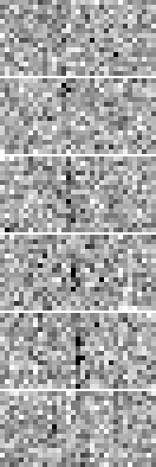

# SETI-KIC8462852-AGBT17A_999_68-2106.529127: likely interference (indicated: known interference bands; crowding)

Checked by `check.py` (vetting 3 (9 Nov 2026: check 6 takes its chance from each file's hits over the band searched near the candidate)) on 2026-11-09. "Unexplained" is the end of these checks, not a discovery.

- 2106.529127 MHz, drift +0.0918 Hz/s, SNR 10.6, target KIC8462852
- OFF looks' brightest S/N along the track: 5.14; faintest ON look: 5.17; DOT score 0.079; ON drifts spread 0.0 steps



## The checks

| # | check | result | strength |
|---|---|---|---|
| 1 | data sanity | sound |  |
| 2 | OFF looks below the threshold | nothing in the OFF looks (brightest S/N 5.14) |  |
| 3 | known interference bands | space operation and research uplinks | indicated |
| 4 | zero or very low drift | +0.0918 Hz/s |  |
| 5 | drift against the Earth's | observed +0.0918, Earth's -0.1063 Hz/s, difference +0.1981 |  |
| 6 | recurrence at other targets and times | 0 match(es) in 0 hits elsewhere |  |
| 7 | look-alikes in the cadence | 627 look-alike(s), 213 in OFF looks | coincidence possible |
| 8 | harmonics and intermodulation | 2 MHz spacing, 10 MHz spacing, 15 MHz spacing, 25 MHz spacing, 30 MHz spacing, 3f1+-2f2 | coincidence possible |
| 9 | crowding | 365 hits in the MHz around it, band median 0 a MHz | indicated |
| 10 | report | likely interference (indicated: known interference bands; crowding) |  |

## blc1's ten steps

| step | what | here |
|---|---|---|
| 1 | instruments working | automated (check 1) |
| 2 | not in the OFF looks below the threshold | automated (check 2) |
| 3 | catalogued interference at the frequency | automated (check 3: a band list, no observatory database) |
| 4 | drift against human technology's | automated in part (check 4: zero drift only) |
| 5 | drift against the target's and the solar system's | automated (check 5: the Earth's part) |
| 6 | other instances in the observatory's archive | automated in part (check 6: this project's store only) |
| 7 | similar signals at other frequencies, same observation | automated (check 7) |
| 8 | whether those are the same phenomenon | automated in part (checks 7, 8 with chance rates); judged by hand |
| 9 | those tested for interference with their OFF looks | automated (check 7) |
| 10 | re-observation, same and other instruments | not possible from archive data: the project has no telescope |

## The evidence

```json
{
 "data sanity": {
  "every_look_complete": true,
  "stamps_finite": true,
  "blank_stamp_spectra": 0,
  "flagged_fraction": 0.25
 },
 "OFF looks below the threshold": {
  "off_snr_max": 5.14,
  "threshold": 6.0,
  "per_look": [
   {
    "position": 1,
    "track_snr": 5.13,
    "track_snr_fixed": 2.11,
    "hit_snr": null
   },
   {
    "position": 3,
    "track_snr": 5.14,
    "track_snr_fixed": 3.5,
    "hit_snr": null
   },
   {
    "position": 5,
    "track_snr": 3.32,
    "track_snr_fixed": 3.05,
    "hit_snr": null
   }
  ]
 },
 "known interference bands": {
  "band": [
   2025.0,
   2110.0,
   "space operation and research uplinks"
  ]
 },
 "zero or very low drift": {
  "drift_hz_s": 0.0918,
  "one_step_hz_s": 0.0102
 },
 "drift against the Earth's": {
  "observed": 0.0918,
  "expected": -0.1063,
  "rotation": -0.1025,
  "orbit": -0.0037,
  "difference": 0.1981
 },
 "recurrence at other targets and times": {
  "matches": [],
  "hits_searched": 0,
  "expected_by_chance": 0.2406,
  "chance": 1.0,
  "close_at_cut": 0,
  "expected_close_at_cut": 0.02962,
  "chance_close": 1.0,
  "background": {
   "source": "measured: each file's hits over the band searched near the candidate",
   "files": 3,
   "searched_mhz": 9.0,
   "hits": 2109,
   "drift_agree_share": 0.4064
  }
 },
 "look-alikes in the cadence": {
  "normalised_drift": 4.357879453142734e-11,
  "tolerance": 9.688217086817469e-12,
  "lookalikes": [
   {
    "position": 0,
    "frequency_mhz": 2105.770855,
    "drift_hz_s": 0.0816,
    "snr": 35.8,
    "shadow": false,
    "mirror": false
   },
   {
    "position": 0,
    "frequency_mhz": 2105.67458,
    "drift_hz_s": 0.0816,
    "snr": 25.2,
    "shadow": false,
    "mirror": false
   },
   {
    "position": 0,
    "frequency_mhz": 2105.960398,
    "drift_hz_s": 0.0714,
    "snr": 25.1,
    "shadow": false,
    "mirror": false
   },
   {
    "position": 0,
    "frequency_mhz": 2106.273291,
    "drift_hz_s": 0.0714,
    "snr": 24.0,
    "shadow": false,
    "mirror": false
   },
   {
    "position": 0,
    "frequency_mhz": 2106.526011,
    "drift_hz_s": 0.0816,
    "snr": 23.4,
    "shadow": false,
    "mirror": false
   },
   {
    "position": 0,
    "frequency_mhz": 2106.020568,
    "drift_hz_s": 0.0816,
    "snr": 20.6,
    "shadow": false,
    "mirror": false
   },
   {
    "position": 0,
    "frequency_mhz": 2105.641486,
    "drift_hz_s": 0.0816,
    "snr": 20.2,
    "shadow": false,
    "mirror": false
   },
   {
    "position": 0,
    "frequency_mhz": 2105.803949,
    "drift_hz_s": 0.0816,
    "snr": 17.3,
    "shadow": false,
    "mirror": false
   },
   {
    "position": 0,
    "frequency_mhz": 2105.794925,
    "drift_hz_s": 0.0714,
    "snr": 17.1,
    "shadow": false,
    "mirror": false
   },
   {
    "position": 0,
    "frequency_mhz": 2106.37859,
    "drift_hz_s": 0.0816,
    "snr": 17.1,
    "shadow": false,
    "mirror": false
   },
   {
    "position": 0,
    "frequency_mhz": 2105.590339,
    "drift_hz_s": 0.0816,
    "snr": 17.0,
    "shadow": false,
    "mirror": false
   },
   {
    "position": 0,
    "frequency_mhz": 2106.104807,
    "drift_hz_s": 0.0918,
    "snr": 16.9,
    "shadow": false,
    "mirror": false
   },
   {
    "position": 0,
    "frequency_mhz": 2106.008535,
    "drift_hz_s": 0.0714,
    "snr": 16.6,
    "shadow": false,
    "mirror": false
   },
   {
    "position": 0,
    "frequency_mhz": 2106.694493,
    "drift_hz_s": 0.0816,
    "snr": 16.4,
    "shadow": false,
    "mirror": false
   },
   {
    "position": 0,
    "frequency_mhz": 2106.838905,
    "drift_hz_s": 0.0816,
    "snr": 16.2,
    "shadow": false,
    "mirror": false
   },
   {
    "position": 0,
    "frequency_mhz": 2105.828019,
    "drift_hz_s": 0.0714,
    "snr": 15.8,
    "shadow": false,
    "mirror": false
   },
   {
    "position": 0,
    "frequency_mhz": 2105.806958,
    "drift_hz_s": 0.0816,
    "snr": 15.4,
    "shadow": false,
    "mirror": false
   },
   {
    "position": 0,
    "frequency_mhz": 2106.420712,
    "drift_hz_s": 0.0714,
    "snr": 15.2,
    "shadow": false,
    "mirror": false
   },
   {
    "position": 0,
    "frequency_mhz": 2107.157817,
    "drift_hz_s": 0.0816,
    "snr": 14.9,
    "shadow": false,
    "mirror": false
   },
   {
    "position": 0,
    "frequency_mhz": 2107.124722,
    "drift_hz_s": 0.0816,
    "snr": 14.7,
    "shadow": false,
    "mirror": false
   },
   {
    "position": 0,
    "frequency_mhz": 2106.089767,
    "drift_hz_s": 0.0714,
    "snr": 14.6,
    "shadow": false,
    "mirror": false
   },
   {
    "position": 0,
    "frequency_mhz": 2106.065697,
    "drift_hz_s": 0.0816,
    "snr": 14.5,
    "shadow": false,
    "mirror": false
   },
   {
    "position": 0,
    "frequency_mhz": 2106.778734,
    "drift_hz_s": 0.0816,
    "snr": 14.4,
    "shadow": false,
    "mirror": false
   },
   {
    "position": 0,
    "frequency_mhz": 2105.97544,
    "drift_hz_s": 0.0714,
    "snr": 14.1,
    "shadow": false,
    "mirror": false
   },
   {
    "position": 0,
    "frequency_mhz": 2106.1018,
    "drift_hz_s": 0.0816,
    "snr": 13.9,
    "shadow": false,
    "mirror": false
   },
   {
    "position": 0,
    "frequency_mhz": 2105.746788,
    "drift_hz_s": 0.0714,
    "snr": 13.8,
    "shadow": false,
    "mirror": false
   },
   {
    "position": 0,
    "frequency_mhz": 2105.858102,
    "drift_hz_s": 0.0918,
    "snr": 13.8,
    "shadow": false,
    "mirror": false
   },
   {
    "position": 0,
    "frequency_mhz": 2106.174008,
    "drift_hz_s": 0.0714,
    "snr": 13.8,
    "shadow": false,
    "mirror": false
   },
   {
    "position": 0,
    "frequency_mhz": 2106.447789,
    "drift_hz_s": 0.0816,
    "snr": 13.7,
    "shadow": false,
    "mirror": false
   },
   {
    "position": 0,
    "frequency_mhz": 2106.213118,
    "drift_hz_s": 0.0816,
    "snr": 13.6,
    "shadow": false,
    "mirror": false
   }
  ],
  "in_off": 213,
  "expected_by_chance": 2.6429,
  "chance": 2.220446049250313e-16,
  "off_hits": 259,
  "note": "chance assumes OFF hits' drifts spread evenly over +-4 Hz/s; near zero drift, where interference crowds, it is called a possible coincidence"
 },
 "harmonics and intermodulation": {
  "relations": [
   "2 MHz spacing",
   "10 MHz spacing",
   "15 MHz spacing",
   "25 MHz spacing",
   "30 MHz spacing",
   "3f1+-2f2"
  ],
  "chance": 0.95,
  "hits_compared": 42902,
  "strong_zero_drift": 12851,
  "trials": 200
 },
 "crowding": {
  "hits_near": 365,
  "median_per_mhz": 0.0,
  "ratio": 365.0
 },
 "report": {
  "checklist": [
   {
    "step": 1,
    "what": "instruments working",
    "here": "automated (check 1)"
   },
   {
    "step": 2,
    "what": "not in the OFF looks below the threshold",
    "here": "automated (check 2)"
   },
   {
    "step": 3,
    "what": "catalogued interference at the frequency",
    "here": "automated (check 3: a band list, no observatory database)"
   },
   {
    "step": 4,
    "what": "drift against human technology's",
    "here": "automated in part (check 4: zero drift only)"
   },
   {
    "step": 5,
    "what": "drift against the target's and the solar system's",
    "here": "automated (check 5: the Earth's part)"
   },
   {
    "step": 6,
    "what": "other instances in the observatory's archive",
    "here": "automated in part (check 6: this project's store only)"
   },
   {
    "step": 7,
    "what": "similar signals at other frequencies, same observation",
    "here": "automated (check 7)"
   },
   {
    "step": 8,
    "what": "whether those are the same phenomenon",
    "here": "automated in part (checks 7, 8 with chance rates); judged by hand"
   },
   {
    "step": 9,
    "what": "those tested for interference with their OFF looks",
    "here": "automated (check 7)"
   },
   {
    "step": 10,
    "what": "re-observation, same and other instruments",
    "here": "not possible from archive data: the project has no telescope"
   }
  ],
  "rio": "not needed"
 }
}
```
