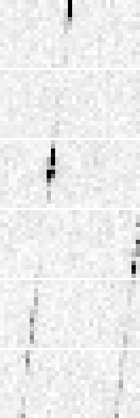

# SETI-KIC8462852-AGBT17A_999_68-2197.160631: interference (shown: recurrence at other targets and times)

Checked by `check.py` (vetting 4 (11 Nov 2026: checks 7 and 9 take their chances from the session's measured occupancy, by drift (occupancy.py), when the store gives it)) on 2026-11-11. "Unexplained" is the end of these checks, not a discovery.

- 2197.160631 MHz, drift +0.0000 Hz/s, SNR 68.1, target KIC8462852
- OFF looks' brightest S/N along the track: 3.47; faintest ON look: 8.46; DOT score 0.03; ON drifts spread 2.0 steps



## The checks

| # | check | result | strength |
|---|---|---|---|
| 1 | data sanity | not sound |  |
| 2 | OFF looks below the threshold | nothing in the OFF looks (brightest S/N 3.47) |  |
| 3 | known interference bands | in no listed band |  |
| 4 | zero or very low drift | +0.0000 Hz/s (under one drift step) | indicated |
| 5 | drift against the Earth's | observed +0.0000, Earth's -0.1020 Hz/s, difference +0.1020 |  |
| 6 | recurrence at other targets and times | 3 match(es) in 3 hits elsewhere, 3 within 3 days with the drift agreeing (3 at the cut) | shown |
| 7 | look-alikes in the cadence | 11992 look-alike(s), 5995 in OFF looks | indicated |
| 8 | harmonics and intermodulation | 2 MHz spacing, 16 MHz spacing, 2f1+-1f2, 3f1+-2f2 | coincidence possible |
| 9 | crowding | 5317 hits at its drift within 0.5 MHz; as many at 0.48% of the band's places | indicated |
| 10 | report | interference (shown: recurrence at other targets and times) |  |

## blc1's ten steps

| step | what | here |
|---|---|---|
| 1 | instruments working | automated (check 1) |
| 2 | not in the OFF looks below the threshold | automated (check 2) |
| 3 | catalogued interference at the frequency | automated (check 3: a band list, no observatory database) |
| 4 | drift against human technology's | automated in part (check 4: zero drift only) |
| 5 | drift against the target's and the solar system's | automated (check 5: the Earth's part) |
| 6 | other instances in the observatory's archive | automated in part (check 6: this project's store only) |
| 7 | similar signals at other frequencies, same observation | automated (check 7) |
| 8 | whether those are the same phenomenon | automated in part (checks 7, 8 with chance rates); judged by hand |
| 9 | those tested for interference with their OFF looks | automated (check 7) |
| 10 | re-observation, same and other instruments | not possible from archive data: the project has no telescope |

## The evidence

```json
{
 "data sanity": {
  "every_look_complete": false,
  "stamps_finite": true,
  "blank_stamp_spectra": 0,
  "flagged_fraction": 1.0
 },
 "OFF looks below the threshold": {
  "off_snr_max": 3.47,
  "threshold": 6.0,
  "per_look": [
   {
    "position": 1,
    "track_snr": 3.47,
    "track_snr_fixed": 3.47,
    "hit_snr": null
   },
   {
    "position": 3,
    "track_snr": 1.51,
    "track_snr_fixed": 1.51,
    "hit_snr": null
   },
   {
    "position": 5,
    "track_snr": 1.51,
    "track_snr_fixed": 1.51,
    "hit_snr": null
   }
  ]
 },
 "known interference bands": {
  "band": null
 },
 "zero or very low drift": {
  "drift_hz_s": 0.0,
  "one_step_hz_s": 0.0102
 },
 "drift against the Earth's": {
  "observed": 0.0,
  "expected": -0.102,
  "rotation": -0.0982,
  "orbit": -0.0039,
  "difference": 0.102
 },
 "recurrence at other targets and times": {
  "matches": [
   {
    "frequency_mhz": 2197.160575,
    "drift_hz_s": 0.0102,
    "snr": 21.1,
    "mjd": 57898.26311342593,
    "target": "KIC8462852_OFF",
    "session": "AGBT17A_999_68",
    "shadow": false,
    "days": 0.004,
    "drift_agrees": true
   },
   {
    "frequency_mhz": 2197.160536,
    "drift_hz_s": 0.0,
    "snr": 11.5,
    "mjd": 57898.278078703705,
    "target": "KIC8462852_OFF",
    "session": "AGBT17A_999_68",
    "shadow": false,
    "days": 0.019,
    "drift_agrees": true
   },
   {
    "frequency_mhz": 2197.160723,
    "drift_hz_s": 0.0,
    "snr": 14.6,
    "mjd": 57898.278078703705,
    "target": "KIC8462852_OFF",
    "session": "AGBT17A_999_68",
    "shadow": false,
    "days": 0.019,
    "drift_agrees": true
   }
  ],
  "hits_searched": 3,
  "expected_by_chance": 0.5072,
  "chance": 0.01493956040727884,
  "close_at_cut": 3,
  "expected_close_at_cut": 0.5068,
  "chance_close": 0.01490859609050399,
  "background": {
   "source": "measured: each file's hits over the band searched near the candidate",
   "files": 3,
   "searched_mhz": 9.0,
   "hits": 7608,
   "drift_agree_share": 0.9992
  }
 },
 "look-alikes in the cadence": {
  "normalised_drift": 0.0,
  "tolerance": 9.288584181845413e-12,
  "lookalikes": [
   {
    "position": 0,
    "frequency_mhz": 2197.164822,
    "drift_hz_s": 0.0,
    "snr": 2026.4,
    "shadow": false,
    "mirror": false
   },
   {
    "position": 0,
    "frequency_mhz": 2197.196821,
    "drift_hz_s": 0.0,
    "snr": 1989.7,
    "shadow": false,
    "mirror": false
   },
   {
    "position": 0,
    "frequency_mhz": 2197.173383,
    "drift_hz_s": 0.0,
    "snr": 1359.8,
    "shadow": false,
    "mirror": false
   },
   {
    "position": 0,
    "frequency_mhz": 2197.175758,
    "drift_hz_s": 0.0,
    "snr": 1253.9,
    "shadow": false,
    "mirror": false
   },
   {
    "position": 0,
    "frequency_mhz": 2197.168197,
    "drift_hz_s": 0.0,
    "snr": 1161.4,
    "shadow": false,
    "mirror": false
   },
   {
    "position": 0,
    "frequency_mhz": 2197.191759,
    "drift_hz_s": 0.0,
    "snr": 1115.3,
    "shadow": false,
    "mirror": false
   },
   {
    "position": 0,
    "frequency_mhz": 2197.162944,
    "drift_hz_s": 0.0,
    "snr": 1081.3,
    "shadow": false,
    "mirror": false
   },
   {
    "position": 0,
    "frequency_mhz": 2197.197944,
    "drift_hz_s": 0.0,
    "snr": 1072.6,
    "shadow": false,
    "mirror": false
   },
   {
    "position": 0,
    "frequency_mhz": 2197.185134,
    "drift_hz_s": 0.0,
    "snr": 1058.4,
    "shadow": false,
    "mirror": false
   },
   {
    "position": 0,
    "frequency_mhz": 2197.165945,
    "drift_hz_s": 0.0,
    "snr": 1051.3,
    "shadow": false,
    "mirror": false
   },
   {
    "position": 0,
    "frequency_mhz": 2197.177319,
    "drift_hz_s": 0.0,
    "snr": 985.4,
    "shadow": false,
    "mirror": false
   },
   {
    "position": 0,
    "frequency_mhz": 2197.194947,
    "drift_hz_s": 0.0,
    "snr": 959.2,
    "shadow": false,
    "mirror": false
   },
   {
    "position": 0,
    "frequency_mhz": 2197.184008,
    "drift_hz_s": 0.0,
    "snr": 926.0,
    "shadow": false,
    "mirror": false
   },
   {
    "position": 0,
    "frequency_mhz": 2197.167946,
    "drift_hz_s": 0.0,
    "snr": 892.5,
    "shadow": false,
    "mirror": false
   },
   {
    "position": 0,
    "frequency_mhz": 2197.185757,
    "drift_hz_s": 0.0,
    "snr": 874.0,
    "shadow": false,
    "mirror": false
   },
   {
    "position": 0,
    "frequency_mhz": 2197.18032,
    "drift_hz_s": 0.0,
    "snr": 864.0,
    "shadow": false,
    "mirror": false
   },
   {
    "position": 0,
    "frequency_mhz": 2197.189945,
    "drift_hz_s": 0.0,
    "snr": 829.1,
    "shadow": false,
    "mirror": false
   },
   {
    "position": 0,
    "frequency_mhz": 2197.190697,
    "drift_hz_s": 0.0,
    "snr": 800.7,
    "shadow": false,
    "mirror": false
   },
   {
    "position": 0,
    "frequency_mhz": 2197.19707,
    "drift_hz_s": 0.0,
    "snr": 795.2,
    "shadow": false,
    "mirror": false
   },
   {
    "position": 0,
    "frequency_mhz": 2197.164009,
    "drift_hz_s": 0.0,
    "snr": 793.9,
    "shadow": false,
    "mirror": false
   },
   {
    "position": 0,
    "frequency_mhz": 2197.171634,
    "drift_hz_s": 0.0,
    "snr": 792.1,
    "shadow": false,
    "mirror": false
   },
   {
    "position": 0,
    "frequency_mhz": 2197.167133,
    "drift_hz_s": 0.0,
    "snr": 764.3,
    "shadow": false,
    "mirror": false
   },
   {
    "position": 0,
    "frequency_mhz": 2197.173947,
    "drift_hz_s": 0.0,
    "snr": 745.7,
    "shadow": false,
    "mirror": false
   },
   {
    "position": 0,
    "frequency_mhz": 2197.16357,
    "drift_hz_s": 0.0,
    "snr": 739.8,
    "shadow": false,
    "mirror": false
   },
   {
    "position": 0,
    "frequency_mhz": 2197.190758,
    "drift_hz_s": 0.0,
    "snr": 735.1,
    "shadow": false,
    "mirror": false
   },
   {
    "position": 0,
    "frequency_mhz": 2197.180756,
    "drift_hz_s": 0.0,
    "snr": 734.4,
    "shadow": false,
    "mirror": false
   },
   {
    "position": 0,
    "frequency_mhz": 2197.185321,
    "drift_hz_s": 0.0,
    "snr": 726.0,
    "shadow": false,
    "mirror": false
   },
   {
    "position": 0,
    "frequency_mhz": 2197.166384,
    "drift_hz_s": 0.0,
    "snr": 723.4,
    "shadow": false,
    "mirror": false
   },
   {
    "position": 0,
    "frequency_mhz": 2197.196008,
    "drift_hz_s": 0.0,
    "snr": 720.0,
    "shadow": false,
    "mirror": false
   },
   {
    "position": 0,
    "frequency_mhz": 2197.199945,
    "drift_hz_s": 0.0,
    "snr": 716.1,
    "shadow": false,
    "mirror": false
   }
  ],
  "in_off": 5995,
  "expected_by_chance": 30.6128,
  "chance": 0.003257328990228013,
  "off_hits": 6000,
  "method": "measured",
  "measured": {
   "observed": 5995,
   "blocks": 307,
   "blocks_with_as_many": 0,
   "chance": 0.003257328990228013,
   "median_per_block": 0.0
  },
  "note": "chance: the share of the session's other blocks whose OFF looks hold as many hits at the cut with this drift over frequency (occupancy.py)"
 },
 "harmonics and intermodulation": {
  "relations": [
   "2 MHz spacing",
   "16 MHz spacing",
   "2f1+-1f2",
   "3f1+-2f2"
  ],
  "chance": 1.0,
  "hits_compared": 72555,
  "strong_zero_drift": 31713,
  "trials": 200
 },
 "crowding": {
  "hits_near": 5879,
  "median_per_mhz": 0.0,
  "ratio": 5879.0,
  "chance": 0.0047870218518682684,
  "method": "measured",
  "measured": {
   "near": 5317,
   "near_at_cut": 5317,
   "drift_tolerance_hz_s": 0.0204,
   "places": 90244,
   "places_as_crowded": 432,
   "chance": 0.0047870218518682684,
   "median_per_place": 13.0,
   "cut_short": true,
   "hits": "SNR 5 and up (shadow hits included), within 0.5 MHz, own 5 kHz left out"
  }
 },
 "report": {
  "checklist": [
   {
    "step": 1,
    "what": "instruments working",
    "here": "automated (check 1)"
   },
   {
    "step": 2,
    "what": "not in the OFF looks below the threshold",
    "here": "automated (check 2)"
   },
   {
    "step": 3,
    "what": "catalogued interference at the frequency",
    "here": "automated (check 3: a band list, no observatory database)"
   },
   {
    "step": 4,
    "what": "drift against human technology's",
    "here": "automated in part (check 4: zero drift only)"
   },
   {
    "step": 5,
    "what": "drift against the target's and the solar system's",
    "here": "automated (check 5: the Earth's part)"
   },
   {
    "step": 6,
    "what": "other instances in the observatory's archive",
    "here": "automated in part (check 6: this project's store only)"
   },
   {
    "step": 7,
    "what": "similar signals at other frequencies, same observation",
    "here": "automated (check 7)"
   },
   {
    "step": 8,
    "what": "whether those are the same phenomenon",
    "here": "automated in part (checks 7, 8 with chance rates); judged by hand"
   },
   {
    "step": 9,
    "what": "those tested for interference with their OFF looks",
    "here": "automated (check 7)"
   },
   {
    "step": 10,
    "what": "re-observation, same and other instruments",
    "here": "not possible from archive data: the project has no telescope"
   }
  ],
  "rio": "not needed"
 }
}
```
