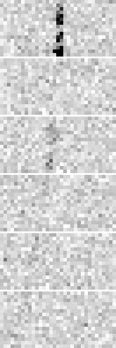

# SETI-HIP436-AGBT16A_999_248-1587.696054-v5: likely interference (indicated: known interference bands)

Checked by `check.py` (vetting 5 (20 Nov 2026: check 8 leaves the candidate's own hits out of the strong zero-drift hits, which with a - b = 1 made a*f1 - b*f2 = f by themselves; check 6 keeps the same target's other sessions apart, as a repeat at the target, not interference; check 1 calls a look of unknown completeness or a missing stamp not sound. No recorded verdict of version 4 changes: tools/vetting_checks.py)) on 2026-11-27. "Unexplained" is the end of these checks, not a discovery.

- 1587.696054 MHz, drift -0.2245 Hz/s, SNR 54.0, target HIP436
- OFF looks' brightest S/N along the track: 4.95; faintest ON look: 5.55; DOT score 0.017; ON drifts spread 2.0 steps (flagged)



## The checks

| # | check | result | strength |
|---|---|---|---|
| 1 | data sanity | not sound |  |
| 2 | OFF looks below the threshold | nothing in the OFF looks (brightest S/N 4.95) |  |
| 3 | known interference bands | GPS L1, GLONASS L1, Galileo, BeiDou | indicated |
| 4 | zero or very low drift | -0.2245 Hz/s |  |
| 5 | drift against the Earth's | observed -0.2245, Earth's -0.0487 Hz/s, difference -0.1758 |  |
| 6 | recurrence at other targets and times | 1 match(es) in 1 hits elsewhere | coincidence possible |
| 7 | look-alikes in the cadence | 9 look-alike(s), 9 in OFF looks | coincidence possible |
| 8 | harmonics and intermodulation | 2 MHz spacing, 10 MHz spacing, 15 MHz spacing, 16 MHz spacing, 30 MHz spacing, 2f1+-1f2, 3f1+-1f2, 3f1+-2f2 | coincidence possible |
| 9 | crowding | 82 hits at its drift within 0.5 MHz; as many at 6.51% of the band's places |  |
| 10 | report | likely interference (indicated: known interference bands) |  |

## blc1's ten steps

| step | what | here |
|---|---|---|
| 1 | instruments working | automated (check 1) |
| 2 | not in the OFF looks below the threshold | automated (check 2) |
| 3 | catalogued interference at the frequency | automated (check 3: a band list, no observatory database) |
| 4 | drift against human technology's | automated in part (check 4: zero drift only) |
| 5 | drift against the target's and the solar system's | automated (check 5: the Earth's part) |
| 6 | other instances in the observatory's archive | automated in part (check 6: this project's store only) |
| 7 | similar signals at other frequencies, same observation | automated (check 7) |
| 8 | whether those are the same phenomenon | automated in part (checks 7, 8 with chance rates); judged by hand |
| 9 | those tested for interference with their OFF looks | automated (check 7) |
| 10 | re-observation, same and other instruments | not possible from archive data: the project has no telescope |

## The evidence

```json
{
 "data sanity": {
  "every_look_complete": false,
  "stamps_finite": true,
  "blank_stamp_spectra": 0,
  "flagged_fraction": 0.15625
 },
 "OFF looks below the threshold": {
  "off_snr_max": 4.95,
  "threshold": 6.0,
  "per_look": [
   {
    "position": 1,
    "track_snr": 3.19,
    "track_snr_fixed": 1.79,
    "hit_snr": null
   },
   {
    "position": 3,
    "track_snr": 4.95,
    "track_snr_fixed": 3.49,
    "hit_snr": null
   },
   {
    "position": 5,
    "track_snr": 2.11,
    "track_snr_fixed": 2.94,
    "hit_snr": null
   }
  ]
 },
 "known interference bands": {
  "band": [
   1559.0,
   1610.0,
   "GPS L1, GLONASS L1, Galileo, BeiDou"
  ]
 },
 "zero or very low drift": {
  "drift_hz_s": -0.2245,
  "one_step_hz_s": 0.0102
 },
 "drift against the Earth's": {
  "observed": -0.2245,
  "expected": -0.0487,
  "rotation": -0.073,
  "orbit": 0.0243,
  "difference": -0.1758
 },
 "recurrence at other targets and times": {
  "matches": [
   {
    "frequency_mhz": 1587.695596,
    "drift_hz_s": 2.0613,
    "snr": 6.2,
    "mjd": 57598.76269675926,
    "target": "Hip39764",
    "session": "AGBT16A_999_248",
    "shadow": true,
    "days": 0.012,
    "drift_agrees": false
   }
  ],
  "hits_searched": 1,
  "expected_by_chance": 1.2935,
  "chance": 0.7256973224285388,
  "close_at_cut": 0,
  "expected_close_at_cut": 0.00226,
  "chance_close": 1.0,
  "background": {
   "source": "measured: each file's hits over the band searched near the candidate",
   "files": 21,
   "searched_mhz": 45.0,
   "hits": 8567,
   "drift_agree_share": 0.0407
  },
  "same_target_hits_left_out": 0
 },
 "look-alikes in the cadence": {
  "normalised_drift": -1.413998601523261e-10,
  "tolerance": 1.285416779279851e-11,
  "lookalikes": [
   {
    "position": 1,
    "frequency_mhz": 1588.129374,
    "drift_hz_s": -0.2143,
    "snr": 15.7,
    "shadow": false,
    "mirror": false
   },
   {
    "position": 1,
    "frequency_mhz": 1587.106371,
    "drift_hz_s": -0.2143,
    "snr": 14.3,
    "shadow": false,
    "mirror": false
   },
   {
    "position": 1,
    "frequency_mhz": 1587.263372,
    "drift_hz_s": -0.2143,
    "snr": 13.9,
    "shadow": false,
    "mirror": false
   },
   {
    "position": 1,
    "frequency_mhz": 1588.286372,
    "drift_hz_s": -0.2143,
    "snr": 13.7,
    "shadow": false,
    "mirror": false
   },
   {
    "position": 1,
    "frequency_mhz": 1588.097372,
    "drift_hz_s": -0.2143,
    "snr": 12.0,
    "shadow": false,
    "mirror": false
   },
   {
    "position": 1,
    "frequency_mhz": 1587.26537,
    "drift_hz_s": -0.2041,
    "snr": 11.3,
    "shadow": false,
    "mirror": false
   },
   {
    "position": 1,
    "frequency_mhz": 1586.67337,
    "drift_hz_s": -0.2041,
    "snr": 10.4,
    "shadow": false,
    "mirror": false
   },
   {
    "position": 1,
    "frequency_mhz": 1588.079373,
    "drift_hz_s": -0.2245,
    "snr": 10.4,
    "shadow": false,
    "mirror": false
   },
   {
    "position": 1,
    "frequency_mhz": 1588.256371,
    "drift_hz_s": -0.2143,
    "snr": 10.2,
    "shadow": false,
    "mirror": false
   }
  ],
  "in_off": 9,
  "expected_by_chance": 0.2143,
  "chance": 0.12052117263843648,
  "off_hits": 21,
  "method": "measured",
  "measured": {
   "observed": 9,
   "blocks": 307,
   "blocks_with_as_many": 37,
   "chance": 0.12052117263843648,
   "median_per_block": 0.0
  },
  "note": "chance: the share of the session's other blocks whose OFF looks hold as many hits at the cut with this drift over frequency (occupancy.py)"
 },
 "harmonics and intermodulation": {
  "relations": [
   "2 MHz spacing",
   "10 MHz spacing",
   "15 MHz spacing",
   "16 MHz spacing",
   "30 MHz spacing",
   "2f1+-1f2",
   "3f1+-1f2",
   "3f1+-2f2"
  ],
  "chance": 1.0,
  "hits_compared": 353814,
  "strong_zero_drift": 117010,
  "trials": 200
 },
 "crowding": {
  "hits_near": 11,
  "median_per_mhz": 6.0,
  "ratio": 1.83,
  "chance": 0.06505695669518195,
  "method": "measured",
  "measured": {
   "near": 82,
   "near_at_cut": 6,
   "drift_tolerance_hz_s": 0.0225,
   "places": 90244,
   "places_as_crowded": 5871,
   "chance": 0.06505695669518195,
   "median_per_place": 8.0,
   "cut_short": true,
   "hits": "SNR 5 and up (shadow hits included), within 0.5 MHz, own 5 kHz left out"
  }
 },
 "report": {
  "checklist": [
   {
    "step": 1,
    "what": "instruments working",
    "here": "automated (check 1)"
   },
   {
    "step": 2,
    "what": "not in the OFF looks below the threshold",
    "here": "automated (check 2)"
   },
   {
    "step": 3,
    "what": "catalogued interference at the frequency",
    "here": "automated (check 3: a band list, no observatory database)"
   },
   {
    "step": 4,
    "what": "drift against human technology's",
    "here": "automated in part (check 4: zero drift only)"
   },
   {
    "step": 5,
    "what": "drift against the target's and the solar system's",
    "here": "automated (check 5: the Earth's part)"
   },
   {
    "step": 6,
    "what": "other instances in the observatory's archive",
    "here": "automated in part (check 6: this project's store only)"
   },
   {
    "step": 7,
    "what": "similar signals at other frequencies, same observation",
    "here": "automated (check 7)"
   },
   {
    "step": 8,
    "what": "whether those are the same phenomenon",
    "here": "automated in part (checks 7, 8 with chance rates); judged by hand"
   },
   {
    "step": 9,
    "what": "those tested for interference with their OFF looks",
    "here": "automated (check 7)"
   },
   {
    "step": 10,
    "what": "re-observation, same and other instruments",
    "here": "not possible from archive data: the project has no telescope"
   }
  ],
  "rio": "not needed"
 }
}
```
