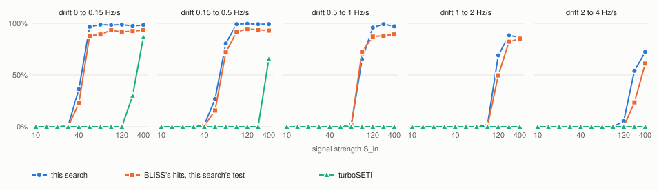

# Comparing radio-signal searches on Breakthrough Listen data

Ryan Clinton. Version 0.1, 2026-11-18 (draft, not released).

## Summary

I compared a narrowband radio-signal search of my own (SignalSearchYoke) with two published pipelines, turboSETI and BLISS, on recorded Breakthrough Listen observations from the Green Bank Telescope, by planting 13,310 synthetic signals in the data and counting how many each pipeline found, and how many false candidates each raised, on the same blocks.

On a 2017 session (KIC8462852), at the cut where each gives at most 0.1 false candidates a block, this search found 4,520 of the 13,310 signals in all three ON looks, turboSETI 442. BLISS as published never reached that false-candidate rate at any cut tested. BLISS's own hits put through this search's ON/OFF test did reach it, and found 4,048.

On a second session, fixed in advance (HIP17147, 2016), this search again found far more than turboSETI (4,337 against 417), but both pipelines **failed** the false-candidate limit set beforehand: 39.1 and 1.27 a block against 0.1, almost all of this search's in known satellite bands. That failure is part of the result.

These are two sessions from one telescope. They do not show better sensitivity in general.

## The question

Searches for narrowband technosignatures look for a tone drifting steadily in frequency that appears when the telescope points at the target (ON) and disappears when it points away (OFF). Two things decide how good a search is: how many real signals it finds, and how many interference signals it wrongly keeps. A pipeline can always find more by keeping more, so the fair comparison is how many planted signals each finds at the same rate of false candidates.

## Method

- **Data.** Breakthrough Listen's high-resolution spectra (about 2.8 Hz channels) of a whole ON-OFF cadence: three ON looks at the target, each followed by an OFF look elsewhere. 121 blocks of frequency per session: 61 crowded with interference and 60 clean, chosen at random within each class and weighted by each class's share of the session.
- **Planted signals.** 110 a block, in the ON looks only, across 11 strengths (S_in 10 to 400, the signal-to-noise a search would give collecting all its power in ideal noise) and five drift bins up to 4 Hz/s.
- **Found** means detected in all three ON looks within ±6 Hz and ±0.05 Hz/s of the planted signal (the tolerances of Margot et al. 2023).
- **False candidates** are counted by running each pipeline with the wrong looks called ON: the 19 other ways of choosing three of the six looks. Anything a pipeline keeps under a wrong choice is interference or noise. Candidates sharing a hit count once.
- **Matched comparison.** Each pipeline's cut (its signal-to-noise threshold) is set where it gives at most 0.1 false candidates a block, and recovery is compared there.
- **Pipelines.** turboSETI 2.3.2; BLISS at commit 2b98afe with its GPU backend and its own event stage; this search, which sums along every drift up to ±4 Hz/s with the smear removed, keeps hits from S/N 5 as shadow hits, and calls a candidate only when every ON look shows the signal and no OFF look does.
- **The second session** used criteria frozen before its data was read, with a fingerprint of the code checked at each stage.

## Results: the 2017 session (KIC8462852, AGBT17A_999_68)

| pipeline | cut | false candidates a block (95% interval) | signals found of 13,310 |
|---|---|---|---|
| this search | 30 | 0.068 (0.023 to 0.13) | 4,520 |
| turboSETI | 30 | 0.049 (0 to 0.13) | 442 |
| BLISS's hits, this search's ON/OFF test | 30 | 0.052 (0.0065 to 0.12) | 4,048 |
| BLISS as published | none reaches 0.1 | lowest 4.54 (at 100) | — |

All three matched pipelines meet the 0.1-a-block target at the tested cut, with different measured false rates. On the same 13,310 signals, this search and BLISS's hits through its test both found 3,829; this search alone 691, BLISS's hits alone 219. The difference, +0.035 of the signals (0.0261 to 0.0456, block bootstrap, 4000 draws, seed 2), holds for this session, these cuts and this signal grid.

*Figure 1. Share of the planted signals found in all three ON looks at each pipeline's matched cut, against signal strength (the eleven steps of the grid, evenly spaced), one panel per drift range (242 signals at each point).*

**Why BLISS as published has no matched cut.** On the two blocks that carry most of its false candidates, one list of BLISS's hits at S/N 30 was given to each ON/OFF logic in the same run:

False candidates at S/N 30 (distinct, over the 19 wrong choices):

| block | BLISS's event stage | this search's test | this search's test, with shadow hits | this search's test, hits grouped at S/N 5 |
|---|---|---|---|---|
| 35 | 1,610 | 85 | 85 | 1 |
| 129 | 2,627 | 205 | 130 | 0 |

With the hits the same, this search's test removes most of them: BLISS's event stage is the larger cause. The rest come from BLISS grouping its hits at the higher cut; grouped at S/N 5 and cut afterwards, almost none are left. These are two blocks, run after the main result was seen.

## Results: the 2016 session, fixed in advance (HIP17147, AGBT16A_999_192)

| criterion, frozen before the data was read | result |
|---|---|
| this search's false rate | **fails** |
| turboSETI's false rate | **fails** |
| this search's recovery above turboSETI's | **holds** |
| the pass's false rate | **fails** |
| the pass's curved recovery above production's | **holds** |
| the pass loses none of production's recoveries | **holds** |

At the frozen cut (30), this search raised 39.1 false candidates a block (13.6 to 69.2) and turboSETI 1.27 (0.268 to 2.8), against a limit of 0.1. Recovery held: 4,337 of 13,310 against 417; paired, +0.294 of the signals (0.284 to 0.304). A second pass for curved tracks, tested with it, found 2,769 of 7,260 curved signals against production's 389, losing none.

Looked at afterwards, not one of the criteria: nearly all of this search's false candidates lie in blocks overlapping known satellite bands (GNSS, Inmarsat). No band has been masked, and the test has not been changed, because that would be choosing the rule after seeing the result.

## Limitations

- Two observing sessions, one telescope, one recording pipeline. Nothing here speaks for Parkes, MeerKAT or another receiver, or for an interference environment unlike Green Bank's.
- Steady drifts within ±4 Hz/s, plus one experiment with curved tracks; no pulsed or broadband signals.
- The 2017 session's cuts were chosen on the same blocks they were judged on. Only the 2016 session was fixed in advance, and there both false rates failed.
- BLISS's hits through this search's test, and the same-hit control, are combinations of two pipelines, designed after the main result was seen.
- Open: the signals BLISS finds that this search misses are being traced one by one.

## Data and code availability

The observations are from the Breakthrough Listen Open Data Archive (Lebofsky et al. 2019, PASP 131, 124505). Breakthrough Listen is managed by the Breakthrough Initiatives. The code and the result records behind every number here are to be deposited on Zenodo with this version.

## References

- Lebofsky, M. et al. 2019, PASP 131, 124505: The Breakthrough Listen search for intelligent life: public data, formats, reduction and archiving.
- Margot, J.-L. et al. 2023, AJ 166, 206: A search for technosignatures around 11,680 stars with the Green Bank Telescope at 1.15-1.73 GHz. doi:10.3847/1538-3881/acfda4 (the ±6 Hz, ±0.05 Hz/s tolerances).

## Revisions

- 0.1 (2026-11-18): first draft.

## Records this version was written from

- data/measurements/matched-bliss.json: written 2026-11-18T13:42:14Z, commit 5fbaa17
- data/measurements/step10.json: written 2026-11-14T09:41:25Z, commit de48e39
- bliss_control/block_035.json: finished 2026-11-18T15:20:01Z
- bliss_control/block_129.json: finished 2026-11-18T15:37:02Z
